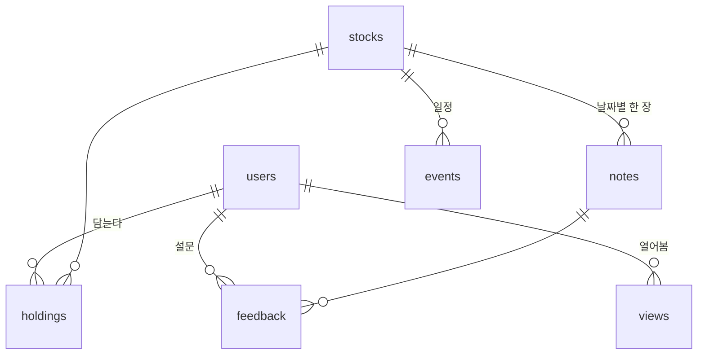

# 한장 — ERD v0.1

> 1·2단계(모바일 웹 + 20명 시험)에 필요한 것만. SQLite. 근거는 [PRD.md](PRD.md).
> **원칙: 노트 내용은 계산하지 않고 받은 JSON 그대로 저장한다.** 한장의 DB 는 「누가 무엇을 봤나」를 재기 위해 있다.

## 관계



## 테이블

### `users` — 시험 사용자

| 컬럼 | 타입 | 비고 |
|---|---|---|
| `id` | integer PK | |
| `email` | text unique not null | 로그인·주간 안내. 받는 개인정보는 이것뿐 |
| `cohort` | text | `trial-1` 등. 시험 묶음 |
| `created_at` | timestamp | 시험 주차 계산의 기준 |

로그인 토큰은 테이블 없이 서명된 링크(만료 15분)로 처리한다.

### `stocks` — 노트가 있는 종목 (약 200개)

| 컬럼 | 타입 | 비고 |
|---|---|---|
| `ticker` | text PK | `005930` |
| `name` | text not null | 검색용 |

노트 JSON 을 받을 때 함께 갱신한다. 유니버스 밖 종목은 여기 없다 → 「아직 노트가 없어요」.

### `holdings` — 내 종목

| 컬럼 | 타입 | 비고 |
|---|---|---|
| `user_id` | FK users | |
| `ticker` | FK stocks | |
| `added_at` | timestamp | |

PK `(user_id, ticker)`. 수량·평단가는 받지 않는다 (PRD F2).

### `notes` — 받은 기업 노트

| 컬럼 | 타입 | 비고 |
|---|---|---|
| `ticker` | FK stocks | |
| `as_of` | date | 퀀트점프 기준일 |
| `body` | json not null | PRD §5.1 의 종목 하나 객체 그대로 |
| `src_version` | int | JSON 계약 `version` |
| `imported_at` | timestamp | |

PK `(ticker, as_of)`. 같은 날 다시 받으면 덮어쓴다(멱등). 금지어 검사(PRD §4.7)에 걸린 노트는 넣지 않는다.

### `events` — 캘린더 일정

| 컬럼 | 타입 | 비고 |
|---|---|---|
| `ticker` | FK stocks | |
| `date` | date | |
| `kind` | text | `EARNINGS` · `DIVIDEND` · `AGM` · `OTHER` |
| `title` | text | 쉬운 말 한 줄 |
| `url` | text | DART 원문 |

PK `(ticker, date, kind)`. 노트 JSON 의 `events` 에서 채운다.

### `views` — 열어본 기록 (시험 판정의 원천)

| 컬럼 | 타입 | 비고 |
|---|---|---|
| `id` | integer PK | |
| `user_id` | FK users | |
| `page` | text | `cards` · `note` · `calendar` |
| `ticker` | text null | `note` 일 때만 |
| `at` | timestamp | |

지우지 않는다. 주별 재방문은 아래 한 줄로 본다:

```sql
-- 주차별: 노트를 1번 이상 연 사용자 수
select cast((julianday(v.at) - julianday(u.created_at)) / 7 as int) + 1 as week, count(distinct v.user_id)
from views v join users u on u.id = v.user_id
where v.page = 'note' group by week;
```

### `feedback` — 주간 설문

| 컬럼 | 타입 | 비고 |
|---|---|---|
| `id` | integer PK | |
| `user_id` | FK users | |
| `ticker` | text | |
| `as_of` | date | 어느 노트에 대한 답인가 |
| `helpful` | int | 1~5 |
| `would_pay` | int null | 6주째만. 월 얼마(원), 안 낸다면 0 |
| `comment` | text | |
| `at` | timestamp | |

## 안 만든 것

| 테이블 | 안 만든 이유 | 만들 때 |
|---|---|---|
| 세션·로그인 토큰 | 서명된 링크·쿠키로 충분 | 앱 단계 |
| 가격 시계열 | 차트는 노트 JSON 의 `spark` 로 충분 | 직접 시세를 받게 될 때 |
| 수급 | 데이터 사용권 없음 | 데이터 계약 후 |
| 뉴스 | 노트 JSON 안에 있다 | ① 경제 뉴스 화면(3단계) |
| 용어 사전 | 코드 안 상수 dict | 100개 넘거나 사람이 고치게 될 때 |
