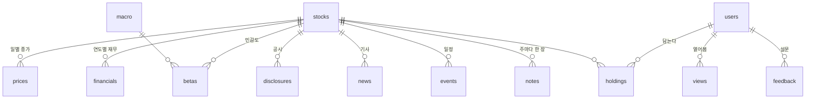

# 한장 — ERD v0.2

> 1·2단계(모바일 웹 + 20명 시험)에 필요한 것만. SQLite. 근거는 [PRD.md](PRD.md).
> v0.2 (2026-10-07) — **한장이 데이터를 직접 받고 노트를 직접 만든다** (퀀트점프 없이). 그래서 표가 두 묶음이다:
> **재료** (주간 노트 만들기가 채운다) · **서비스** (사용자가 채운다).
> **`prices` · `betas` 는 아직 만들지 않았다** — 시세를 쓸 권리가 없다 ([data-rights.md](data-rights.md) §4). 시세를 사면 만든다.
> 2026-10-07 추가 열: `financials.basis`(CFS 연결·OFS 별도) · `stocks.induty_code`(DART 업종 코드 — 화면의 업종 이름표) · `disclosures.amount`(자기주식 취득 예정 금액, DART 전용 API).
> 공시는 `last_reprt_at=Y` 로 정정 최종본만 받고, 받은 기간 안에서 최종본이 아닌 옛 판은 지운다. 분류는 서식 이름 규칙(`notes.TITLE_RULES`)이 먼저, 나머지만 AI.
> 금융회사(은행·보험·증권)는 DART 에 「매출액」이 없다 — `financials.revenue` 가 비는 게 정상이다.
> 모든 재료 표는 같은 데이터를 다시 받아도 중복이 생기지 않게 PK 로 덮어쓴다(멱등).

## 관계



---

## A. 재료 — 주간 노트 만들기(F9)가 채운다

### `stocks` — 노트를 만드는 종목 (코스피 시총 상위 약 100개)

| 컬럼 | 타입 | 비고 |
|---|---|---|
| `ticker` | text PK | `005930` |
| `name` | text not null | 검색용 |
| `corp_code` | text | DART 고유번호 (공시·재무 조회 키) |
| `active` | bool | 유니버스 안이면 true. 분기마다 시총 순위로 다시 고른다 — 빠진 종목은 false 로 두고 지우지 않는다 |

### `prices` — 일별 종가 (공공데이터포털)

| 컬럼 | 타입 | 비고 |
|---|---|---|
| `ticker` | FK stocks | |
| `date` | date | |
| `close` | integer | 받은 그대로의 종가 |
| `adj_close` | real | **수정주가** — 분할·증자를 보정한 값. 수익률·52주·민감도는 전부 이 열로 |
| `mktcap` | integer | 시가총액 (유니버스 고르기) |

PK `(ticker, date)`. 보정 계산은 퀀트점프 코드를 복사한다 — 보정 안 한 종가로 수익률을 내면 분할 날 −80% 같은 거짓 숫자가 예외 없이 나온다.

### `macro` — 거시 지표 (ECOS · FRED)

| 컬럼 | 타입 | 비고 |
|---|---|---|
| `series_id` | text | `ECOS:<표>:<항목>` — 환율·국고채(일별), `ECOS:902Y002:KOR`·`USA` OECD 주가지수(월별, 날짜는 그 달 1일 · 읽기 팁 「오래 들고 있으면」 글) |
| `date` | date | |
| `value` | real | |

PK `(series_id, date)`.

### `financials` — 연도별 재무 (DART)

| 컬럼 | 타입 | 비고 |
|---|---|---|
| `ticker` | FK stocks | |
| `fiscal_year` | int | |
| `revenue` · `operating_income` · `net_income` | integer | 원 |
| `equity` · `liabilities` | integer | 부채비율·ROE 계산용 |
| `rcept_no` | text | 사업보고서 접수번호 → DART 원문 링크 |

PK `(ticker, fiscal_year)`. 증감·PER·PBR·부채비율·ROE 는 저장하지 않고 노트 만들 때 계산한다 (한 곳에서만 계산).

### `disclosures` — 공시 + AI 판독

| 컬럼 | 타입 | 비고 |
|---|---|---|
| `rcept_no` | text PK | DART 접수번호 |
| `ticker` | FK stocks | |
| `date` | date | |
| `title` | text | |
| `code` | text null | AI 판독: 분류 (`BUYBACK` `DIVIDEND` `RIGHTS_ISSUE` … `OTHER`) |
| `importance` | int null | 1~5 |
| `direction` | int null | −1 · 0 · +1 (호재/악재 — 노트에선 「반가운 소식/걸리는 소식」으로만) |
| `risk_tags` | json null | 사업보고서일 때: 「소송」「잠재 부채」 등 |
| `new_share` · `quote` | real · text null | 사업보고서일 때: 작년에 없던 문장 비율 · 인용 1문장 |
| `read_model` · `read_at` | text · timestamp null | 비어 있으면 아직 안 읽음 → 다음 실행에서 읽는다 |

### `betas` — 거시 민감도

| 컬럼 | 타입 | 비고 |
|---|---|---|
| `ticker` | FK stocks | |
| `as_of` | date | |
| `series_id` | text | `macro.series_id` |
| `beta` · `r2` | real | r2 가 낮으면(기준은 복사해 올 코드 그대로) 노트에 싣지 않는다 |
| `window_days` | int | 250 |

PK `(ticker, as_of, series_id)`. 지표 **전부** 저장한다 — 노트에는 뚜렷한 것만 싣고, 나중에 「뉴스↔내 종목」(3단계)이 나머지를 쓴다.

### `news` — 기사 (제목·매체·링크만)

| 컬럼 | 타입 | 비고 |
|---|---|---|
| `url` | text PK | 언론사 원문 주소 (중계 주소는 풀어서) |
| `ticker` | FK stocks | |
| `date` | date | |
| `press` | text | |
| `title` | text | |

본문은 저장하지 않는다 (불변식 3).

### `holidays` — 공휴일 (한국천문연구원 특일 정보 · 이용 제한 없음)

| 컬럼 | 타입 | 비고 |
|---|---|---|
| `date` | text PK | 공휴일·대체공휴일·선거일 |
| `name` | text | 「추석」「대체공휴일(개천절)」 |

캘린더의 빨간 날. 올해·내년치를 받는다. 12월 31일 증시 휴장은 코드가 덧붙인다.

### `events` — 캘린더 일정

| 컬럼 | 타입 | 비고 |
|---|---|---|
| `ticker` | FK stocks | |
| `date` | date | |
| `kind` | text | `EARNINGS` · `DIVIDEND` · `AGM` · `OTHER` |
| `title` | text | 쉬운 말 한 줄 |
| `rcept_no` | text | DART 원문 |

PK `(ticker, date, kind)`. 공시에서 뽑는다.

### `insiders` — 지분 보고 (DART 임원·주요주주 소유보고 · 5% 대량보유 보고)

| 컬럼 | 타입 | 비고 |
|---|---|---|
| `rcept_no` | PK | DART 접수번호 |
| `ticker` | FK stocks | |
| `date` | date | 보고일 |
| `kind` | text | `임원` · `5%` |
| `who` | text | 임원은 **직위만**(이름은 받지 않는다 — 노트에 쓸 일이 없다) · 5% 는 보고자(기관) 이름 |
| `change` | integer | 보유 주식 증감(주) |
| `rate` | real | 보유 비율 % (5% 만) |
| `rate_chg` | real | 직전 보고 대비 %p (5% 만 · DART 값이 주식 증감과 부호가 어긋나는 일이 있어 노트엔 안 쓴다) |

### `notes` — 만든 기업 노트

| 컬럼 | 타입 | 비고 |
|---|---|---|
| `ticker` | FK stocks | |
| `week` | date | 그 주 월요일 |
| `facts` | json not null | 사실 묶음 — AI 에게 준 입력 그대로 (나중에 「왜 이렇게 썼나」를 되짚는다) |
| `body` | json not null | 화면에 그리는 노트 (절·문장·링크) |
| `writer` | text | `llm:<모델>` 또는 `code` (숫자 대조 검사에서 떨어져 코드 문장으로 대신한 경우) |
| `made_at` | timestamp | |

PK `(ticker, week)`. 같은 주에 다시 만들면 덮어쓴다 — 화~일은 사실이 바뀐 종목만 다시 만든다(`made_at` 이 그 주 월요일보다 뒤면 화면에 「고침」).

---

## B. 서비스 — 사용자가 채운다

### `users` — 시험 사용자

| 컬럼 | 타입 | 비고 |
|---|---|---|
| `id` | integer PK | |
| `email` | text unique not null | 로그인·주간 안내. 받는 개인정보는 이것뿐 |
| `cohort` | text | `trial-1` 등. 시험 묶음 |
| `created_at` | timestamp | 시험 주차 계산의 기준 |

로그인 토큰은 테이블 없이 서명된 링크(만료 15분)로 처리한다.

### `holdings` — 내 종목

| 컬럼 | 타입 | 비고 |
|---|---|---|
| `user_id` | FK users | |
| `ticker` | FK stocks | |
| `added_at` | timestamp | |

PK `(user_id, ticker)`. 수량·평단가는 받지 않는다 (PRD F2).

### `views` — 열어본 기록 (시험 판정의 원천)

| 컬럼 | 타입 | 비고 |
|---|---|---|
| `id` | integer PK | |
| `user_id` | FK users | |
| `page` | text | `cards` · `note` · `calendar` |
| `ticker` | text null | `note` 일 때만 |
| `at` | timestamp | |

지우지 않는다. 주별 재방문은 아래 한 줄로 본다:

```sql
-- 주차별: 노트를 1번 이상 연 사용자 수
select cast((julianday(v.at) - julianday(u.created_at)) / 7 as int) + 1 as week, count(distinct v.user_id)
from views v join users u on u.id = v.user_id
where v.page = 'note' group by week;
```

### `likes` — 좋아요 (2026-10-08)

| 컬럼 | 타입 | 비고 |
|---|---|---|
| `user_id` | FK users | |
| `ticker` | FK stocks | |
| `week` | date | 그 주 노트 — 주가 바뀌면 새로 센다 |
| `at` | timestamp | |

PK `(user_id, ticker, week)` — 한 사람이 한 노트에 한 번. 다시 누르면 지운다. 화면에는 **개수만**(누가 눌렀는지는 안 보인다). 노트 위의 「읽음」은 `views` 에서 그 주 노트를 연 횟수를 센다. 탈퇴하면 함께 지운다.

### `users` 에 더한 칸 (2026-10-08)

`nickname` (남에게 보이는 이름, 한글·영문·숫자·_ 2~20자, 대소문자 무시 유일 — 비어 있으면 남에게 안 보인다) · `bio` (자기소개, 150자, 선택). **이메일은 어떤 화면에도 남에게 보이지 않는다.**

### `follows` — 팔로우

| 컬럼 | 타입 | 비고 |
|---|---|---|
| `follower_id` | FK users | 팔로우하는 사람 |
| `followee_id` | FK users | 팔로우받는 사람 (닉네임이 있어야 한다) |
| `at` | timestamp | |

PK `(follower_id, followee_id)`. 다시 누르면 지운다.

### `regrams` — 리그램 (좋아한 글을 내 팔로워 피드에)

| 컬럼 | 타입 | 비고 |
|---|---|---|
| `id` | PK | |
| `user_id` | FK users | 닉네임이 있어야 할 수 있다 |
| `kind` | text | `note`(종목 노트) · `learn`(읽기 팁 글) |
| `ref` | text | 종목 코드 또는 글 slug |
| `week` | date | 노트는 그 주 · 읽기 팁은 빈 글 |
| `comment` | text | 쓰지 않음 — 코멘트는 10/8 사용자 요청으로 뺐다(늘 빈 값). 리그램은 아이콘 버튼 하나 |
| `at` | timestamp | |

UNIQUE `(user_id, kind, ref, week)`. 피드 = 내가 팔로우한 사람 + 나의 리그램, 최근 50개. 탈퇴하면 팔로우(양쪽)·리그램을 함께 지운다.

### 보고서·피드 재료 (2026-10-08)

| 표 | 칸 | 비고 |
|---|---|---|
| `dividends` | ticker · fiscal_year · dps(주당 현금배당금, 보통주) · total(원) · payout(%) | DART 「배당에 관한 사항」 — 해마다 3년치씩 두 번 = 6년 |
| `business` | ticker(PK) · rcept_no · body(json: what·segments·risks·year) · read_model · read_at | 사업보고서 「사업의 내용」 요약. 숫자는 원문에 글자 그대로 있어야 저장(코드 대조). 같은 해 보고서는 다시 읽지 않는다 |
| `articles` | id · ref(UNIQUE: 공시·지분 보고 접수번호) · ticker · date · kind · body(json: title·paragraphs·links) · made_at | 피드 「최근 소식」 기사. 한 회사·같은 종류는 14일에 한 편 |
| `prices` | ticker · date · close | ⚠️ `PRICE_DEV=1` 인 내 컴퓨터에서만 — 시세는 남에게 보일 권리가 없다(data-rights §4) |
| `big_pairs` | inst · corp_code · stock_code · corp_name · corp_cls | 큰손 포트폴리오 — 전체 상장사 대량보유 보고(D001)에서 BIG 기관이 보고한 회사 짝 |
| `big_holdings` | inst · stock_code · corp_name · rate(%) · rate_chg(%p) · date · rcept_no | 기관별 5% 넘게 가진 종목(가장 최근 보고). 5% 아래로 내려가면 지운다. 개인은 모으지 않는다 |
| `stocks.homepage` | 도메인 | DART 회사 개황 — 로고(Brandfetch)를 찾는다 |

### `feedback` — 주간 설문

| 컬럼 | 타입 | 비고 |
|---|---|---|
| `id` | integer PK | |
| `user_id` | FK users | |
| `ticker` | text | |
| `week` | date | 어느 노트에 대한 답인가 |
| `helpful` | int | 1~5 |
| `would_pay` | int null | 6주째만. 월 얼마(원), 안 낸다면 0 |
| `comment` | text | |
| `at` | timestamp | |

---

## 안 만든 것

| 테이블 | 안 만든 이유 | 만들 때 |
|---|---|---|
| 세션·로그인 토큰 | 서명된 링크·쿠키로 충분 | 앱 단계 |
| 계산 결과(수익률·PER 등) | 노트 만들 때 계산하고 `notes.facts` 에 남는다 | 화면에서 종목끼리 비교하게 될 때 |
| AI 호출 기록 | `disclosures.read_*` · `notes.writer` 로 충분 | 비용을 종목별로 따져야 할 때 |
| 수급 | 데이터 사용권 없음 | 데이터 계약 후 |
| 용어 사전 | 코드 안 상수 dict | 100개 넘거나 사람이 고치게 될 때 |


## 표 구조 바꾸기 (2026-10-11)

새 열·색인은 `hanjang/db.py` 의 `MIGRATIONS` **맨 끝에** 한 줄 더한다. 번호 순서로 한 번씩만 돌고, 몇 번까지 적용했는지는 DB 파일 안(`pragma user_version`)에 남는다. 앞 줄은 고치지 않는다 — 이미 적용된 DB 에는 다시 돌지 않는다. 열을 지우거나 이름을 바꾸는 일은 아직 없다(SQLite 는 `alter table … drop column` 이 되니 그때도 한 줄이면 된다).
